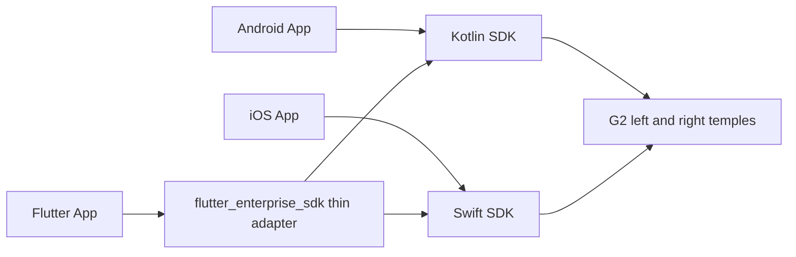

# Native architecture and scope

The native SDK owns scan identity, exact-SN license admission, encrypted GATT connection and enterprise verification on service 8450/AUTH 8403. Only authorization success permits business notification 8402 and business authentication over 8401. The old 5450/5401/5402/5403 entry is not an enterprise fallback. Both temples must complete business AUTH before the pair becomes READY.

Shared protocol definitions and golden vectors are under `native/protocol/`. Kotlin and Swift each implement the native queue, packet/ACK matching and bounded recovery. Unknown protocol identities fail closed. Session/attempt/operation generations prevent stale callbacks changing current owners.

Even Hub native code owns page creation, session IDs, fragmentation and retries, input decoding, microphone admission and page heartbeat. The App supplies logical content and consumes results. LC3 decoding and PCM processing are built into the page-owned microphone path; this release exposes processed audio events rather than a standalone configurable decoder.

G2 OTA is a native two-temple transaction. Completion of transport only moves into reconnect/version verification; only matching installed versions establishes success. Cancellation and recovery are scoped to current operation generations.

Host-owned responsibilities: runtime permissions and Bluetooth UX, secure proof distribution, foreground reconnect policy, remembered-device UI/persistence, content generation and recording/playback/transcription of PCM. R1, consumer services, phone notification composition, arbitrary image conversion and background state restoration are outside this release's high-level host API.

Native source builds live under `native/android` and `native/ios`. The root Swift package distributes the compiled SDK; Flutter is maintained in a separate repository. See the platform guides for the deliberate differences in public Kotlin/Swift APIs.
